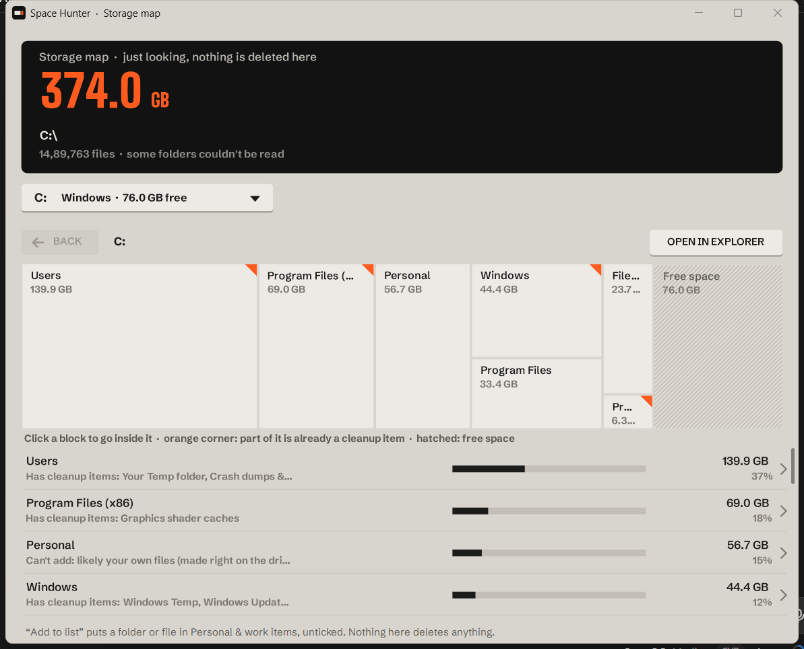
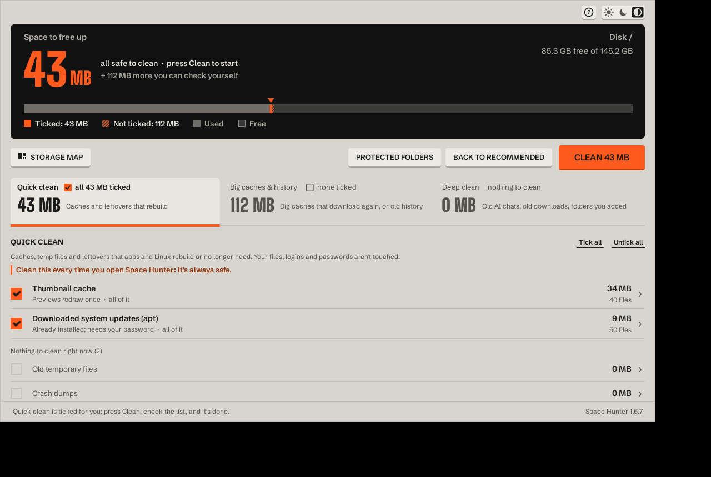

# Space Hunter

**Finds the folders silently filling your disk, explains each one, and clears the ones you pick after one
confirmation.** Free for Windows 10/11, macOS 13+ and Linux. No account, no tracking unless you opt in, a few MB at most.

### [⬇ Download the latest version](https://github.com/knox-101/space-hunter/releases/latest)

Windows: `SpaceHunter.exe` · Mac: `SpaceHunter-mac.zip` · Linux: `SpaceHunter-x86_64.AppImage` (or
`nix run github:knox-101/space-hunter`) · first-run steps are on the download page.

**On a Mac, move it to Applications before you open it.**

1. Unzip `SpaceHunter-mac.zip` and drag **Space Hunter** into **Applications**.
2. Open it from Applications. The first time, macOS refuses because the app isn't from the App Store. Go to
   **System Settings → Privacy & Security** and click **Open Anyway** (on macOS 13–14, right-click the app → **Open**
   also works).

Opened straight from Downloads, macOS runs the app from a hidden read-only copy, and versions up to 1.6.2 then
couldn't update ("doesn't have permission to save"). If that happened to you, download the latest version once by
hand as above; it keeps your settings, and updates install by themselves after that.

## What it does

- **Shows every place separately**: temp files, Windows leftovers, browser and app caches, developer caches (npm,
  pip, Gradle, Xcode…), AI tool leftovers (e.g. Claude Code and Codex history, downloaded models), old installers.
  Only apps you actually have get a row.
- **Sorts them by risk**: **Quick clean** (caches and leftovers that rebuild, ticked at start), **Big caches &
  history** (big caches that download again, or old history) and **Deep clean** (old AI chats and workspaces, old
  downloads, folders you added; these may include your work, so check each one first). The three sections sit on a
  rail at the top, each with its size, what's in it, how much of it is ticked and a box to tick or untick the whole
  section; each one opens with a single line on what to do with it.
- **Explains each one**: click a row to see, in three short lines, what it is, what goes and what happens after
  (more if you want it). Things that fill up over time (Temp, logs, Downloads) let you choose "only older than N"
  or "everything"; caches are simply cleaned whole.
- **What's inside**: every item lists the folders and files it would clean, with their sizes. Its ticks follow the age you choose:
  files too new for it show unticked, and a folder with some newer files shows a dash. Untick anything that
  should always stay, or leave an item unticked and tick just the files you want gone: the item then shows ticked,
  with a small note like "25 of 312 files · 40 MB of 1.2 GB", and only those go, in that one clean. Select all / Clear, folders to open, Back.
- **Asks before cleaning**. **Permanently delete** is chosen to start with, and **Recycle Bin / Trash** is one click
  away, for any clean. It shows each file as it goes; at the end your drive appears as a ring, the space you freed
  crumbles out of it, and a short list says what went.
  Cleaning runs in its own window, so you can keep looking around. On Linux, system folders such as downloaded
  updates ask for your password once.
- **Storage map**: see how your whole disk is split up, folder by folder, on any drive (about 10 seconds for a full
  Windows drive), and add a cache folder to the cleanup list from there.

The same app on Linux (and on Mac), with the same names, look and features:

Light, dark, or follow the system: the three small keys at the top right. The first time you open it, a short
guide walks through everything that matters, one part of the window at a time; the **?** key beside them shows it
again. **Default cleanup** puts the ticks and ages back to the first-time setup and measures everything afresh.

## Safe by design

- Files in use, or changed or added more recently than an item's age setting, are skipped, never forced. Photos you
  copied or unzipped today count as new, whatever their own date.
- Personal folders (Documents, Desktop, Pictures, OneDrive, `.ssh` and similar) are never cleaned. Folders you mark
  as **protected** are never touched, and AI agents' memory folders are always skipped. AI tools' and editors' own
  settings folders (`.claude`, `.codex`, `.vscode` and similar) can't be added to the cleanup list.
- Its only network use is one check on GitHub for a new version when it opens, and the public totals below if you
  say yes. Updates install only if they're signed with the project's key.

## Public totals

Once, after your first visit, Space Hunter asks whether to count you in its public totals. Nothing is sent unless you
click **Count me in**, and you can change your answer any time by clicking the version number at the bottom right.

If you say yes, it sends, at most once a day and after each clean:

- a random install number it made up (so the same copy is counted once; it isn't tied to you or your computer),
- your system (Windows, Mac or Linux) and the Space Hunter version,
- the total space freed and the number of cleans so far.

Never file names, folder paths, what was cleaned, or anything else about your computer. The server keeps no IP
addresses. Its code is in [`stats/`](stats/worker.js), and the totals are public at
[space-hunter-stats.knox-101.workers.dev/stats](https://space-hunter-stats.knox-101.workers.dev/stats).

## More

- [Command line, updates and building from source](docs/advanced.md)
- [Add an app to the cleanup list](CONTRIBUTING.md): no code needed, just an entry in a JSON file
- [What changed in each version](CHANGELOG.md) · [Report a security problem](SECURITY.md)

## Licence

Free software under the [GNU GPL v3 or later](LICENSE): use, study, share and change it; shared changes stay under
the same licence. Copyright (c) 2026 Blesson Reji (knox-101). Fonts: SIL Open Font License, see
[`THIRD-PARTY-NOTICES.md`](THIRD-PARTY-NOTICES.md).
