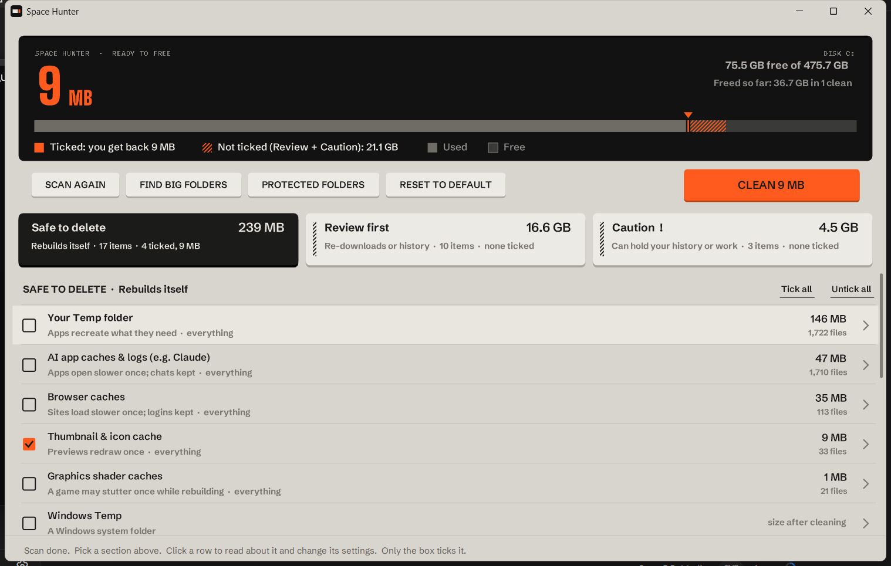
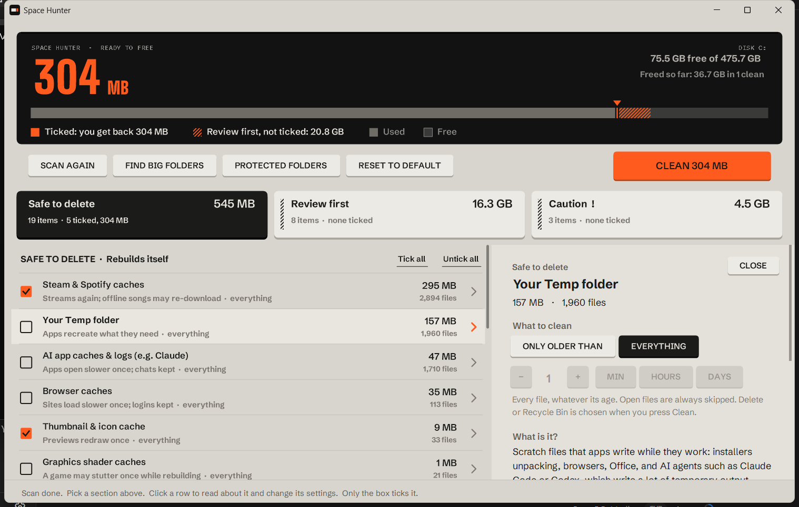
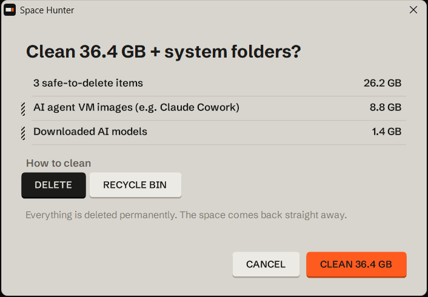
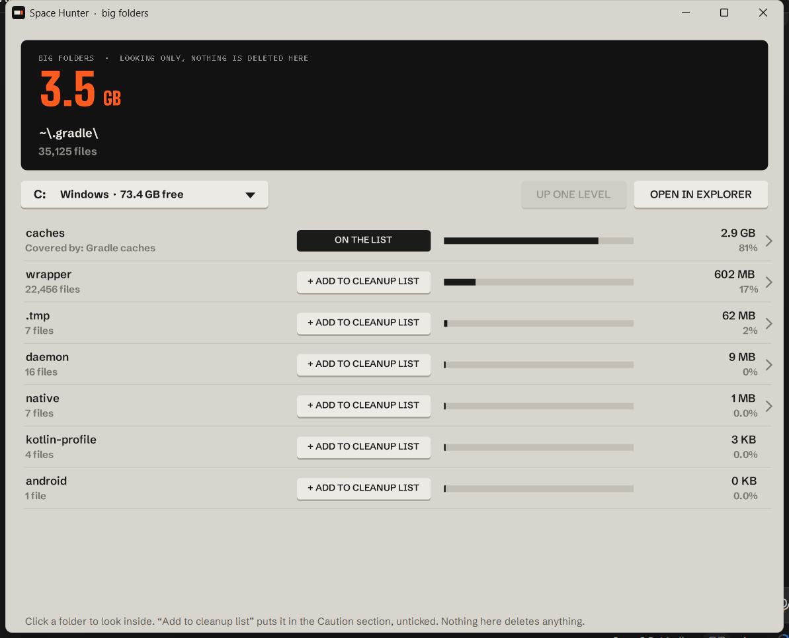

# Space Hunter

**Finds the folders silently filling your disk, tells you what each one is, and clears the ones you pick in one
confirmed click.** For Windows 10/11 and macOS 13+. Offline, no account, no telemetry, under 1 MB.



Most disk cleaners show a single "junk" number and a scary button. Space Hunter shows **every place separately**,
with its size, what's inside, what gets deleted, whether that's safe, and what happens afterwards, so you can decide
item by item.

## What it finds

| Section | Ticked at start | Examples |
|---|---|---|
| **Safe to delete**: rebuilds itself | yes | Temp folders, Windows Update leftovers, Windows logs, crash dumps, thumbnail cache, graphics shader caches (including Steam's), graphics driver installer leftovers, browser caches (Chrome, Edge, Brave, Vivaldi, Opera, Firefox), chat app caches, app logs (e.g. OneDrive, Zoom), game launcher caches (e.g. Epic, Battle.net), Adobe media cache, AI app caches and logs (e.g. Claude), code editor and IDE caches (e.g. VS Code, JetBrains), npm / Yarn / pip / uv / Go build caches, Win+R history |
| **Review first**: comes back by re-downloading, or is history | no | The previous Windows installation (`Windows.old`), Prefetch, Steam and Spotify caches, AI agent VM images (e.g. Claude Cowork), downloaded AI models (e.g. Hugging Face), AI tool runtimes (e.g. Codex), npx packages, browser-automation browsers, Gradle, Maven, NuGet, Cargo, Go module, pnpm and conda caches, game engine caches (e.g. Unity, Unreal), Android emulator snapshots, the Recycle Bin |
| **Caution**: can hold your history or work | no | Old AI agent chat history (Claude Code, Codex), old AI agent workspaces, old installers and archives in Downloads, and any folder you add yourself |

**Only apps you have show up.** There are 43 items on Windows and 33 on Mac, but a row appears only if that app's
folders exist on your computer, so the list stays short.

The Mac version has the same sections with the macOS equivalents: app caches, logs and crash reports, Mail
attachment copies, Xcode DerivedData, device support and simulator caches, old iPhone and iPad backups, and the
Trash.

Click any row to open its panel: what it is, what gets deleted, whether it's safe, what happens after, and
**"only files older than N days"** or **"everything"**.



## Cleaning

The **Clean** key always asks first, listing every ticked item, and lets you choose **Delete** (space back now) or
**Recycle Bin / Trash** (restorable). A live log shows each file as it goes, and **Stop** works at any point.



## Find big folders

Measures a whole drive and shows the biggest folders, level by level. On Windows it reads the drive's own file index
(NTFS), so a full drive with 1.5 million files takes about 10 seconds instead of a minute or more. Each file is
counted once, even when Windows lists it in several folders. One drive key opens a list of every drive with its
free space; the window dims behind the list until you pick one. Folders that are safe to clear can be put on the
cleanup list. Nothing is deleted from this window.



## Safety

- Files that are in use, or were changed more recently than the item's age setting, are skipped, never forced.
- Personal folders (Documents, Desktop, Pictures, Videos, Music, OneDrive, `.ssh` and similar) are never cleaned and
  can't be added to the cleanup list. Windows, Program Files and whole drives can't be added either.
- **Protected folders**: add any folder, and nothing inside it is ever touched.
- AI agents' memory folders are always skipped. Links and junctions are never followed.
- Every clean is logged (`%LOCALAPPDATA%\SpaceHunter\log.txt` on Windows,
  `~/Library/Application Support/SpaceHunter` on Mac).

## Download

Download the latest version from the **Releases** page.

- **Windows**: run `SpaceHunter.exe`. It asks for administrator rights so it can clean Windows' own temp, update and
  log folders. The app isn't code-signed yet, so Windows SmartScreen may warn on the first run: choose
  **More info → Run anyway**.
- **Mac**: unzip, move **Space Hunter** to Applications, then **right-click → Open** the first time (it isn't
  notarized). For the Trash and some caches, allow it under **System Settings → Privacy & Security → Full Disk
  Access**.

## Command line (Windows)

Run these from an **Administrator** terminal. Space Hunter is a windowed app, so redirect the output to a file to
read it.

```bat
SpaceHunter.exe --report > report.txt   :: scan and list every item; deletes nothing
SpaceHunter.exe --auto                  :: clean the ticked Safe-to-delete items WITHOUT asking, then exit
SpaceHunter.exe --version > version.txt
```

`--auto` uses the ticks and ages you last set in the app, and only ever touches **Safe to delete** items. To run it
at sign-in, create a task in Task Scheduler with **Run with highest privileges** checked.

## Build from source

- **Windows**: run `windows\build.cmd`. It uses the C# compiler that ships with Windows, so nothing needs installing.
- **Mac**: `cd mac && ./build.sh` (needs the Xcode Command Line Tools). It builds a universal app for Apple silicon
  and Intel.
- Every push builds both on GitHub Actions (`.github/workflows/build.yml`).
- **Adding an app** needs no code: add an entry to `windows/cleaners.json` or `mac/cleaners.json`. See
  [`CONTRIBUTING.md`](CONTRIBUTING.md).

The version number lives in [`VERSION`](VERSION). Changes are listed in [`CHANGELOG.md`](CHANGELOG.md).

## Repository layout

| Path | What's there |
|---|---|
| `windows/` | The Windows app (C# WinForms, .NET Framework 4.x, which is part of Windows); its items are in `cleaners.json` |
| `mac/` | The Mac app (SwiftUI, one source file); its items are in `cleaners.json` |
| `fonts/` | Big Shoulders Display, Schibsted Grotesk and IBM Plex Mono, shared by both apps |
| `docs/screenshots/` | The images in this README |
| `extras/startup-script/` | The PowerShell script Space Hunter grew from: a small at-sign-in temp cleaner |

## Licence

Space Hunter is free software: you can use, study, share and change it under the
[GNU General Public License v3 or later](LICENSE). If you share a changed version, it must stay under the same licence,
with its source code. Copyright (c) 2026 Blesson Reji (knox-101).

The fonts are under the SIL Open Font License: see [`THIRD-PARTY-NOTICES.md`](THIRD-PARTY-NOTICES.md).
